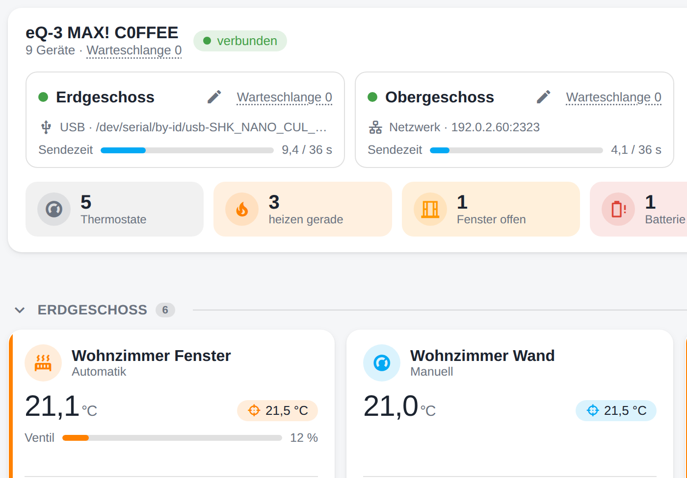
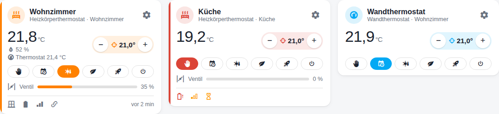
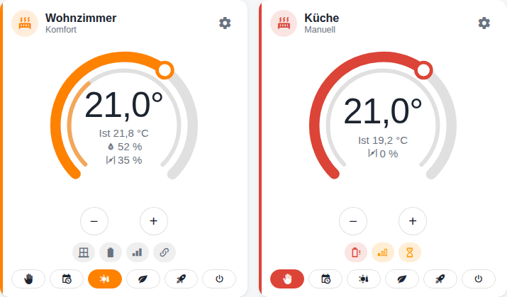
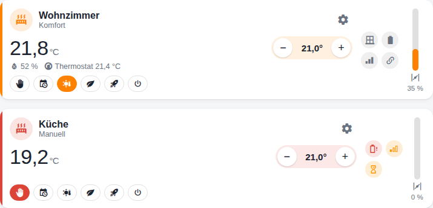

[English](README.md) · **Deutsch**

# eq3_max

Home-Assistant-Integration für eQ-3 MAX! über einen CUL mit culfw: USB-Stick (z. B. nanoCUL868)
oder im Netzwerk (a-culfw auf CUN oder geflashtem MAX! Cube).
Ersetzt Homegear und die legacy `homematic`-Integration.



**Neu in 0.11.0:** Die [Thermostatkarte](#thermostatkarte) wird mitgeliefert, Seite und Karte
übernehmen die Symbole aus Home Assistant (Tür, Garagentor, eigene Symbole), Bereiche auf der
Seite lassen sich einklappen und anordnen – [alles Neue](https://ma-schmitz.github.io/eq3_max/de/neu/).



**Dokumentation:** https://ma-schmitz.github.io/eq3_max/de/ – Installation, Umstieg von Homegear,
Handbuch und FAQ. Quelle im Ordner `website/` (Material for MkDocs, lokal:
`uv venv .venv-docs && uv pip install -p .venv-docs -r requirements_docs.txt &&
.venv-docs/bin/mkdocs serve`).

## Funktionen

- Heizkörper- und Wandthermostate als `climate`, Ventilstellung als eigener Sensor
- Fensterkontakte, Eco-Taster (als Event-Entitäten), Batterie, RSSI, Funkfehler
- Zustand übersteht Neustarts, verlorene Befehle werden erkannt und wiederholt
- Übernahme bestehender Homegear-Kopplungen ohne Neuanlernen; Entity-IDs nach Bestätigung (Reparatur)
- Sendezeit-Sensor und Bremse auf 1 % (36 s pro Stunde, bei neuen Einträgen an)
- Presets „Komfort“, „Eco“ und „Abwesend“ (temporär mit Endzeit), Werksreset und Löschen von Geräten
- Ein Sollwert wirkt je nach Modus wie am Gerät: in **Automatik** gilt eine Änderung bis zum
  nächsten Schaltpunkt des Wochenprogramms (das Thermostat bleibt in Automatik), in **Heizen**
  (manuell) dauerhaft; **Abwesend** hält eine Temperatur bis zur Endzeit, ein neuer Sollwert
  beendet es
- Gruppen-IDs (je Thermostat oder für einen ganzen Raum)
- Eigene Dashboard-Karte, wird mitgeliefert: [Thermostatkarte](#thermostatkarte) (Ventil, Batterie, Funk, Fenster, Einstellungen und Wochenprogramm im Pop-up)
- Freigaben: Geräteeinstellungen und Wochenprogramme für Benutzer ohne Admin-Rechte sperrbar
- Gerätekonfiguration (Komfort-/Eco-Temperatur, Offset, Fenster, Boost, Entkalkung, Ventil;
  Anzeige Soll/Ist am Wandthermostat), jeder Wert per Mouseover und ⓘ erklärt
- Ist-Temperatur der Heizkörper in frei wählbarem Abstand abfragen (für Verlaufskurven)
- Verknüpfungen zwischen Geräten anlegen und lösen (Fensterkontakt, Taster, Wand- und Heizkörperthermostat)
- Virtuelle Geräte: Home Assistant spielt gegenüber den Thermostaten einen Fensterkontakt oder ein Wandthermostat, gespeist aus einer beliebigen Entität
- CUL per USB oder im Netzwerk (CUN, geflashter Cube), Wechsel in den Optionen
- Mehrere Funkmodule mit einer Zentralen-Adresse (z. B. eins pro Etage); Geräte ohne
  Neuanlernen einem anderen Modul zuordnen
- Seite „eQ-3 MAX!“ in der Seitenleiste: Überblick, Verknüpfungen und Gerätekonfiguration
- Deutsch und Englisch: Namen, Meldungen, Dialoge und die Seite folgen der Sprache von Home Assistant

## Thermostatkarte

Die Integration bringt eine eigene Dashboard-Karte mit: `custom:eq3-max-thermostat-card`.
Es ist nichts zu installieren – sie wird als Dashboard-Ressource eingetragen und kommt mit
jedem Update in der passenden Version.

| Ring – zum Ziehen | Kachel |
|---|---|
|  |  |

- Ist- und Solltemperatur, −/+ und die Modi Manuell, Auto, Komfort, Eco, Boost, Aus
- Ventilstellung, Batterie, Funkempfang, verknüpftes Fenster, Bediensperre und ausstehende
  Befehle als Symbole
- Einstellungen und **Wochenprogramm im Pop-up**, ohne das Dashboard zu verlassen
- Drei Layouts: `kompakt`, `ring` (Sollwert durch Ziehen), `kachel`
- Optional ein externer Temperatur- und ein Feuchtesensor

Im Dashboard **Karte hinzufügen → „eQ-3 MAX! Thermostat“** oder als YAML:

```yaml
type: custom:eq3-max-thermostat-card
entity: climate.wohnzimmer
layout: kompakt      # kompakt | ring | kachel
```

Alles Weitere im [Handbuch](https://ma-schmitz.github.io/eq3_max/de/handbuch/karte/). Wer die
Karte bisher getrennt über HACS installiert hatte: dort entfernen und die Integration neu
laden; an den Dashboards ändert sich nichts.

## Verbindung (USB oder Netzwerk)

Der erste Einrichtungsschritt fragt nach der Anbindung:

- **USB-Stick**: serieller Port aus `/dev/serial/by-path/` (38400 Baud), wie bisher.
- **Im Netzwerk suchen**: fragt das eigene Netz auf Port 2323 ab und listet die
  culfw-Module zur Auswahl. Einen geflashten MAX! Cube meldet Home Assistant auch von
  selbst unter „Entdeckt“.
- **Netzwerk: Adresse eingeben (CUN, geflashter Cube)**: Host und Port (Standard 2323). a-culfw auf
  einem CUN oder einem mit a-culfw geflashten MAX! Cube spricht dort dasselbe
  Textprotokoll wie der Stick. Vor dem Weiter wird `V` gesendet; ohne Antwort
  „V …“ binnen 5 s erscheint „Dort antwortet keine culfw“.

Danach geht es wie gewohnt mit Zentralen-Adresse und Geräteübernahme weiter. Die
unique_id bleibt die Zentralen-Adresse.

Die Verbindung lässt sich später unter Optionen → „Verbindung ändern“ wechseln
(USB ↔ Netzwerk oder anderer Port/Host), ohne die Integration neu anzulegen. Sie
wird wie bei der Einrichtung geprüft; eine geänderte Verbindung lädt die
Integration neu. Die gerade genutzte Verbindung wird nicht geprüft, weil die
Integration sie belegt; unverändert gespeichert bleibt sie ohne Neustart. Einträge von vor dieser Option (ohne `connection`) gelten als USB.

Netzwerkverbindung: Verbindungsaufbau mit 10 s Timeout, TCP-Keepalive (ein
verschwundenes Gerät fällt nach etwa 90 s auf) und TCP_USER_TIMEOUT 120 s, wo das
System es kennt; Wiederverbinden alle 30 s. Als Host nur Hostname oder IP-Adresse
eintragen (kein `http://`, kein Pfad). Wenn
der Wächter oder das schnelle Neuöffnen den CUL „neu öffnet“, wird nur die
TCP-Verbindung getrennt und neu aufgebaut. Anders als das Neuöffnen des Sticks
(DTR) setzt das das Funkmodul selbst nicht zurück; hilft es nicht, das Gerät
stromlos machen. a-culfw nimmt je nach Build nur einen TCP-Client gleichzeitig an;
andere Programme auf demselben Port stören. Zeilenenden `\r\n` und `\n` werden
beide akzeptiert.

Die Diagnose nennt Art (`usb`/`network`) und Ziel (Pfad bzw. `host:port`), die
Reparaturmeldung „CUL nicht erreichbar“ das Ziel.

## Mehrere Funkmodule

Unter Optionen → „Funkmodule“ kommen weitere USB-Sticks oder Netzwerk-CULs dazu, jedes mit
einem Namen. Alle arbeiten mit derselben Zentralen-Adresse (wie die Interfaces bei
Homegear). Jedes Gerät sendet über ein zugeordnetes Modul, empfangen wird über alle;
doppelt gehörte Telegramme werden einmal ausgewertet, die Empfangsstärke je Modul gemerkt.
Die Zuordnung ändert die Entität `select.<gerät>_funkmodul` oder der Reiter „Funkmodul“
auf der Seite „eQ-3 MAX!“. Am Gerät passiert dabei nichts, wartende Befehle wechseln mit.
Jedes Modul hat sein eigenes Funkbudget und seine eigene Reparaturmeldung. Details:
`website/handbuch/funkmodule.md`.

## Gerätekonfiguration

Jedes Thermostat hat Konfigurationsentitäten (Kategorie „Konfiguration“ auf
der Geräteseite):

| Schlüssel | HT | WT | Bereich |
|---|---|---|---|
| `komfort`, `eco`, `maximal`, `minimal`, `fenster_temperatur` | ja | ja | 4,5–30,5 °C, Schritt 0,5 |
| `offset` (Messwert-Offset) | ja | ja | −3,5…+3,5 K, Schritt 0,5 |
| `fenster_dauer` | ja | ja | 0–60 min, Schritt 5 |
| `boost_dauer` (Auswahl) | ja | – | „0 min“ … „60 min“ (0, 5, 10, 15, 20, 25, 30, 60) |
| `boost_ventil` | ja | – | 0–100 %, Schritt 5 |
| `entkalkung_tag` (Auswahl) | ja | – | Samstag … Freitag |
| `entkalkung_stunde` | ja | – | 0–23 |
| `ventil_max`, `ventil_offset` | ja | – | 0–100 % |
| `anzeige` (Auswahl) | – | ja | Soll-/Ist-Temperatur im Display; meldet das Gerät selbst |

Die entity_ids folgen dem Gerät, z. B. `number.ht_bad_unten_komfort` oder
`select.ht_bad_unten_entkalkung_tag`.

- Die Geräte nehmen nur ganze Sätze (Temperaturen: Telegramm 0x11, Ventil:
  0x12). Wer einen Wert ändert, schickt den ganzen Satz mit den übrigen
  gespeicherten Werten.
  Werte mit Quelle `werksvorgabe` sind nur angenommen und werden dabei
  trotzdem ins Gerät geschrieben; das Log warnt dann mit „Sende angenommene
  Werksvorgaben mit: …“ und nennt die betroffenen Werte.
- Die Geräte melden ihre Konfiguration nicht zurück. Angezeigt wird der
  zuletzt quittierte Wert; ein gesendeter, noch nicht quittierter steht im
  Attribut `ausstehend` und wird wie ein Stellbefehl wiederholt (nächster
  Status nach Fehlschlag, nach Wiederverbinden und Start). Bei mehreren
  schnellen Änderungen geht nur der neueste Satz raus.
- Attribut `quelle`: `homegear` (aus dem Export übernommen), `werksvorgabe`
  (angenommen, weil unbekannt) oder `gesetzt` (aus HA gesendet und vom Gerät
  quittiert – gilt für alle Werte des Satzes).
- Werksvorgaben nach dem Anlernen: Komfort 21,0, Eco 17,0, Maximal 30,5,
  Minimal 4,5 °C, Offset 0,0 K, Fenster 12,0 °C für 15 min, Boost 5 min bei
  80 %, Entkalkung Samstag 12 Uhr, Ventil maximal 100 %, Ventil-Offset 0 %.
- Konfiguration und Quelle stehen im Konfigurationseintrag (und im
  Speicher); ausstehende Sätze nur im Speicher. Beim Start gilt je Wert der
  Eintrag vor dem Speicher.
- Die Fenster-auf-Temperatur ist zugleich der Wert, an dem die Integration
  einen gemeldeten Fenster-auf-Sollwert von einer Komforttemperatur
  unterscheidet. „Heizen“ ohne gemerkten manuellen Sollwert nimmt die
  Komforttemperatur aus der Konfiguration.

## Verknüpfungen

Verknüpfte Geräte reden direkt miteinander: Ein Fensterkontakt meldet „offen“
an sein Thermostat, ein Wandthermostat führt seine Heizkörperthermostate. Die
Dienste `eq3_max.link` und `eq3_max.unlink` legen eine Verknüpfung an bzw.
lösen sie (Telegramme 0x20 AddLinkPartner und 0x21 RemoveLinkPartner, wie FHEM
`associate`/`deassociate`).

- Erlaubt: Fensterkontakt–Heizkörperthermostat, Fensterkontakt–Wandthermostat,
  Wandthermostat–Heizkörperthermostat, Heizkörperthermostat–Heizkörperthermostat,
  Eco-Taster–Heizkörper- oder Wandthermostat. Andere Paare, ein Gerät mit sich
  selbst, schon verknüpfte (bzw. beim Lösen nicht verknüpfte) Paare und schon
  beauftragte Änderungen lehnt der Dienst mit einer Meldung ab.
- Eine Verknüpfung hat immer zwei Richtungen: Jedes der beiden Geräte bekommt
  den anderen als Partner und quittiert das einzeln. Eine Richtung, die schon
  besteht, wird nicht noch einmal gesendet.
- Der Dienst kehrt nach dem Einreihen sofort zurück. Thermostate bekommen ihren
  Teil gleich. Fensterkontakte und Eco-Taster schlafen und hören nur einen Moment
  nach eigenem Senden zu. Nach einem Fenster-Ereignis meldet sich ein Kontakt erst
  bei der Zentrale, dann bei jedem Partner-Thermostat (40–110 ms Abstand), bei
  unerreichbaren Partnern minutenlang immer wieder: Ihr Teil wartet, bis sie sich
  melden, und geht 80 ms nach dem jeweils letzten Telegramm von oder zu ihnen ohne
  Weckpräambel (`Zf`) raus – ein Versuch je Gelegenheit, 0,5 s Quittungswartezeit;
  sendet das Gerät währenddessen selbst, wird der Versuch aufgegeben und nach dem
  nächsten Telegramm wiederholt. Nie mit Präambel (`Zs`): die kommt nach 1 s immer
  zu spät. Dafür die Anlerntaste kurz drücken (geht bei beiden, auch wenn das
  Gerät schon angelernt ist) oder das Fenster einmal öffnen und schließen bzw. den
  Taster drücken. Ein Fensterkontakt ohne Partner bekommt den Auftrag nur über
  die Anlerntaste: Er hört dann einige Sekunden zu, wiederholt wird alle 0,5 s. Je Druck geht
  eine Verknüpfung raus; danach hat er einen Partner, und die übrigen kommen beim Fenster
  öffnen/schließen (oder mit dem nächsten Druck). Wartende Aufträge überstehen Neustarts; ein
  Werksreset des Geräts verwirft sie.
- Diagnosesensor `sensor.<basis>_verknuepfungen` an jedem Gerät: Zustand ist die
  Zahl der vollständigen Verknüpfungen (beide Richtungen quittiert), Attribut
  `partner` die Namen der Partner, Attribut `ausstehend` je unfertigem Paar
  „<Partner>: <Zustand>“ mit `ausstehend` (eingereiht oder unterwegs),
  „wartet auf Fensterkontakt – bitte Anlerntaste kurz drücken (oder Fenster öffnen und schließen)“
  (bzw. „wartet auf Eco-Taster – bitte Taster einmal drücken (oder
  Anlerntaste)“), `fehlgeschlagen`, `fehlgeschlagen (abgelehnt)` oder
  `einseitig` (nur eines der beiden Geräte kennt die Verknüpfung, nichts
  beauftragt – mit `eq3_max.link` vervollständigen).
- Unquittierte Aufträge an Thermostate gehen wie Stellbefehle erneut raus: beim
  nächsten Status des Geräts, nach dem Wiederverbinden und beim Start. Lehnt ein
  Gerät ab (NAK), bleibt es bei `fehlgeschlagen (abgelehnt)`; erst ein neuer
  Dienstaufruf sendet wieder.
- Quittierte Verknüpfungen (Partner-Seriennummern, Feld `links`) stehen im
  Konfigurationseintrag und im Speicher, offene Aufträge nur im Speicher. Beim
  Start gilt der Eintrag; ein Eintrag ohne `links` nimmt die aus dem Speicher.
- Die Homegear-Übernahme liest die Verknüpfungen per `getLinks`.
- Ein quittierter Werksreset entfernt das Gerät auch aus den Verknüpfungen der
  übrigen Geräte. Partner, die es quittiert in ihrer Liste hatten, bekommen
  RemoveLinkPartner (Thermostate gleich, Schläfer beim nächsten Telegramm);
  bis zur Quittung steht das beim Partner unter `ausstehend`.
- **Auftrag abbrechen.** Ein offener oder fehlgeschlagener Auftrag lässt sich verwerfen, ohne
  dass etwas gesendet wird: Knopf **„Auftrag abbrechen“** auf der Seite „eQ-3 MAX!“ (Reiter
  Verknüpfungen) oder Dienst `eq3_max.cancel_link`. Für Aufträge, die nie abgeschlossen werden
  können, z. B. ein vom Gerät abgelehntes Lösen (`fehlgeschlagen (abgelehnt)`). Verknüpfungen
  und Aufträge zu Geräten, die die Integration nicht mehr hat (über „Gerät löschen“
  entfernt), fallen beim Start von selbst weg; nur ein noch wartendes Lösen bleibt stehen.

```yaml
action: eq3_max.link
data:
  device_id: 0123456789abcdef0123456789abcdef          # z. B. Fensterkontakt
  partner_device_id: fedcba9876543210fedcba9876543210  # z. B. Heizkörperthermostat
```

## Virtuelle Geräte

Ein virtuelles Gerät gibt es nur in Home Assistant, nicht als Hardware. Die Integration
tritt damit gegenüber den echten Heizkörperthermostaten als MAX!-Gerät auf, gespeist aus
einer Entität:

- **Virtueller Fensterkontakt:** Quelle ist ein `binary_sensor` (z. B. ein Zigbee-Fensterkontakt).
  Die Integration meldet „offen“/„geschlossen“ an jedes verknüpfte Thermostat.
- **Virtuelles Wandthermostat:** Quelle ist ein Temperatur-`sensor` (°F und K werden
  umgerechnet). Die Thermostate eines Raums regeln dann nach dieser Temperatur statt nach
  ihrem eigenen Fühler, und ein Sollwert gilt für den ganzen Raum. Die Temperatur geht fest
  alle 5 Minuten hinaus, ein Fensterwechsel sofort. Automatik gibt es nur mit einem
  vollständigen, über eq3_max geschriebenen Wochenprogramm; ohne eines läuft der Raum
  manuell, und die Seite sagt das. In Automatik gilt eine Änderung am Handrad oder in Home
  Assistant bis zum nächsten Schaltpunkt. Eine Abwesenheit endet von selbst zur eingestellten
  Zeit; danach gilt wieder, was vorher galt.

**Anlegen:** Seite „eQ-3 MAX!“ → „Virtuelles Gerät anlegen“ (nur für Administratoren): Art,
Name und Quelle wählen (ein Funkmodul wählt man nicht; das virtuelle Gerät sendet über das
Modul des jeweiligen Thermostats). Danach wie bei einem gekauften Gerät mit den Thermostaten
**verknüpfen**. Soll die Fenster-auf-Erkennung in einem Raum mit virtuellem Wandthermostat
wirken, wird der Fensterkontakt (echt oder virtuell) auch mit dem virtuellen Wandthermostat
verknüpft, nicht nur mit den Thermostaten; fehlt das, zeigt die Seite einen Hinweis.

**Wichtig zu wissen:**

- **Sendezeit.** Jede Funknachricht (ein „Telegramm“) kostet Sendezeit. Ein virtuelles
  Wandthermostat braucht etwa 13 s je Stunde (von 36 s je Stunde und Funkmodul; mit der
  Option „Sendezeit auf 36 s begrenzen“ bleiben 10 s für Befehle frei, ohne sie entscheidet
  das Funkmodul selbst). Richtwert: **zwei virtuelle Wandthermostate je Funkmodul.** Ohne
  gemeinsame Gruppe am gemeinsamen Funkmodul geht die Temperatur an jedes Thermostat einzeln
  (etwa 13 s je Stunde und Thermostat; bei mehr als einem Thermostat regeln sie zeitweise
  nach ihrem eigenen Fühler); die Seite zeigt dann einen Hinweis und bietet „Für den Raum
  vergeben“ an. Ein Thermostat wartet knapp 10 Minuten auf sein Wandthermostat, dann regelt
  es nach dem eigenen Fühler und zeigt einen Funkfehler bis zum nächsten Telegramm. Ein langer
  Auftrag kann einen Raum bis zu etwa einer Stunde ohne Temperatur lassen. Ein Thermostat, das den
  virtuellen Raum verlässt, verliert seine Gruppen-ID.
- **Fensterkontakt.** Ein nicht zugestellter Zustand wird alle 5 Minuten wiederholt, nach
  drei Fehlschlägen alle 15 Minuten; zwei Zustandswechsel an dasselbe Thermostat liegen
  mindestens eine Minute auseinander, und je Thermostat gehen höchstens 12 Telegramme je
  Stunde hinaus.
- **Quelle.** Eine Temperaturquelle, die sich 3 Stunden lang nicht gemeldet hat, gilt als
  nicht verfügbar. Sensoren, die nur bei einer Änderung neu schreiben (Template- oder
  Hilfssensoren), fallen deshalb zeitweise aus; besser ein Gerätesensor, der regelmäßig meldet.
- **Nur am seriellen Funkmodul.** Die mit einem virtuellen Wandthermostat verknüpften
  Thermostate müssen in 0.10.0 an einem per USB oder seriell angeschlossenen Funkmodul
  hängen, nicht an einem Netzwerkmodul (z. B. geflashter Cube). Der virtuelle Fensterkontakt geht mit jedem Modul.
  Einen Eco-Taster gibt es am virtuellen Wandthermostat nicht, und ein Thermostat kann nur
  ein Wandthermostat haben (echt oder virtuell).
- **Home Assistant läuft nicht** (oder die Integration ist nicht geladen: Funkmodul fehlt,
  Integration deaktiviert oder wird neu geladen). Dann antwortet niemand für das virtuelle Wandthermostat;
  die Thermostate heizen mit ihrem eigenen Fühler weiter. Ändert jemand in dieser Zeit den
  Sollwert am Handrad, kostet das das Thermostat Sendezeit: im ungünstigsten Fall wiederholt
  es etwa 16 Minuten lang und ist danach bis zu einer Stunde stumm (es heizt weiter). Dagegen
  gibt es keine technische Abhilfe.
- **Entfernen.** „Entfernen“ löst zuerst die Verknüpfungen an den Thermostaten; das Gerät steht
  bis dahin als „wird entfernt“ da und antwortet weiter. „Trotzdem entfernen“ löscht sofort –
  ein Thermostat, das die Verknüpfung noch kennt, sendet dann ins Leere und kann bis zu einer
  Stunde verstummen.
- **Zurück auf eine ältere Version.** Vor dem Wechsel auf eine Version vor 0.10.0 alle
  virtuellen Geräte entfernen: Eine ältere Version hält sie für echte Geräte an einer
  Adresse, unter der niemand antwortet.

Ausführlich: Handbuch, Seite „Virtuelle Geräte“ (`website/handbuch/virtuelle-geraete.de.md`).

## Seite „eQ-3 MAX!“

Eintrag **„eQ-3 MAX!“** in der Seitenleiste (nur für Administratoren, URL `/eq3-max`); die
Geräteseiten des Funkmoduls und der Geräte verlinken mit „Besuchen“ dorthin
(`configuration_url`). Die Seite ist ein Custom Panel ohne Build-Schritt und ohne
Fremdbibliotheken (`custom_components/eq3_max/frontend/eq3-max-panel.js`, ausgeliefert unter
`/eq3_max_static/`, Cache-Buster aus Version und Inhalt); sie folgt dem hellen bzw. dunklen
HA-Design und passt sich schmalen Bildschirmen an.

- **Kopfzeile je Funkmodul:** verbunden/getrennt, Verbindung (USB-Pfad bzw. `host:port`),
  Sendezeit der letzten Stunde als Balken gegen 36 s, Warteschlange, Knopf
  „Anlernen (60 s)“ mit Countdown (nur bei verbundenem Funkmodul).
- **Gerätekarten nach HA-Bereich** („Ohne Bereich“ zuletzt): Ist → Soll und Modus bzw.
  Preset, Ventilbalken (Heizkörperthermostat), offen/geschlossen (Fensterkontakt),
  Batterie, RSSI, „zuletzt gemeldet“, Zahl der Verknüpfungen; Markierungen „ausstehend“,
  „nicht quittiert“, „Funkfehler“, „Batterie schwach“.
- **Seitenfenster** (Klick auf eine Karte), Reiter **Verknüpfungen:** Partner mit Zustand
  (verknüpft, ausstehend, wartet auf Gerät, fehlgeschlagen, abgelehnt, einseitig) und dem
  Text des Sensors `…_verknuepfungen`, „Lösen“ je Partner, „Erneut senden“ bei
  fehlgeschlagenen, „Partner hinzufügen“ mit nur den Geräten, die der Dienst `link`
  annehmen würde. Bei Fensterkontakten und Tastern der Hinweis, das Fenster einmal zu
  öffnen und zu schließen bzw. den Taster zu drücken.
- Reiter **Konfiguration** (Heizkörper- und Wandthermostat): je Satz („Temperaturen“,
  beim Heizkörperthermostat zusätzlich „Ventil“) ein Formular auf dem Raster der
  Integration, je Wert Quelle (Homegear / Werksvorgabe / gesetzt) und ggf. „ausstehend“ –
  nur bei Werten, die vom quittierten abweichen (gesendet wird immer der ganze Satz; dass
  er unterwegs ist, zeigt „Satz ausstehend“).
  Beliebig viele Werte ändern, dann **„Satz senden“**: Vor dem Senden listet die Seite die
  Änderungen und die angenommenen Werksvorgaben, die mitgehen; gesendet wird **ein**
  Telegramm mit dem ganzen Satz.
- Die Seite aktualisiert sich selbst (Push, entprellt 250 ms); während man tippt, wartet
  die Aktualisierung, bis das Feld verlassen wird.

WebSocket-Befehle (alle nur für Administratoren; Fehler in der Sprache des Benutzers, ab 0.7.0 mit `translation_key`):

| Befehl | Daten | Wirkung |
|---|---|---|
| `eq3_max/overview` | – | Funkmodule, Geräte, Bereiche, Verknüpfungen, Konfiguration |
| `eq3_max/subscribe` | – | Ereignis `{"type": "update"}` nach Änderungen |
| `eq3_max/link`, `eq3_max/unlink` | `device_id`, `partner_device_id` | wie die Dienste `link`/`unlink` |
| `eq3_max/cancel_link` | `device_id`, optional `partner` (Seriennummer) | offene Verknüpfungsaufträge verwerfen, ohne etwas zu senden; Antwort `cancelled` |
| `eq3_max/pair` | `entry_id` | Anlernen 60 s öffnen |
| `eq3_max/rename_radio` | `entry_id`, `radio`, `name` | Funkmodul umbenennen (das Hauptmodul ist `""`); die Integration lädt neu |
| `eq3_max/set_config` | `device_id`, `kind` (`temp`/`valve`), `values` | ganzer Satz in einem Telegramm; Antwort `factory_keys` = mitgesendete Werksvorgaben |

## Dienste

- `eq3_max.set_away` – Thermostate bis zu einem Zeitpunkt auf eine Temperatur
  setzen (MAX!-Modus temporär, danach zurück in Auto). Ohne `temperature` gilt
  die Urlaubstemperatur aus den Optionen; das Ende wird auf die nächste halbe
  Stunde aufgerundet und muss in der Zukunft liegen. Das Preset „Abwesend“
  macht dasselbe mit der Urlaubsdauer aus den Optionen (Standard 18,0 °C, 24 h).
- `eq3_max.factory_reset` – Gerät per Funk auf Werkseinstellungen zurücksetzen.
  Nur wenn es quittiert, wird es aus der Integration entfernt; danach neu
  anlernen. Ohne Quittung kann es trotzdem zurückgesetzt sein – dann per
  „Gerät löschen“ entfernen. Nur vergessen (ohne Funk) geht über „Gerät löschen“ auf der
  Geräteseite.
- `eq3_max.link` / `eq3_max.unlink` – zwei Geräte verknüpfen bzw. die
  Verknüpfung lösen, siehe „Verknüpfungen“.
- `eq3_max.cancel_link` – den offenen Verknüpfungsauftrag eines Geräts mit einem Partner
  (`partner`: Seriennummer oder Gerät) oder alle verwerfen, ohne etwas zu senden.

```yaml
action: eq3_max.set_away
target:
  entity_id: climate.ht_bad_unten
data:
  temperature: 16
  until: "2026-10-12 18:00:00"
```

```yaml
action: eq3_max.factory_reset
data:
  device_id: 0123456789abcdef0123456789abcdef
```

## Installation

Voraussetzung: Home Assistant 2026.8 oder neuer.

Über [HACS](https://hacs.xyz): in HACS nach „eQ-3 MAX!“ suchen, herunterladen, Home Assistant
neu starten und die Integration „eQ-3 MAX!“ hinzufügen.

Von Hand: `custom_components/eq3_max` nach `/config/custom_components/` kopieren, Home Assistant
neu starten, Integration „eQ-3 MAX!“ hinzufügen.

Umstieg von Homegear: siehe `website/umstieg/`.

## Entwicklung

Beiträge sind willkommen – siehe [CONTRIBUTING.md](.github/CONTRIBUTING.md) (englisch, Issues gern auf Deutsch).
Fragen in die [Discussions](https://github.com/ma-schmitz/eq3_max/discussions), Sicherheitslücken vertraulich (siehe [SECURITY.md](.github/SECURITY.md)).

    uv venv -p 3.14 .venv && uv pip install -p .venv -r requirements_test.txt
    .venv/bin/pytest


## Lizenz und Hinweise

MIT-Lizenz, siehe [LICENSE](LICENSE).

eq3_max ist ein privates Projekt und nicht mit der eQ-3 AG verbunden. „eQ-3“, „MAX!“ und
„Homematic“ sind Marken ihrer Inhaber und werden nur beschreibend verwendet.

Funkrecht: Im 868-MHz-Band darf jeder Sender höchstens 1 % der Zeit senden (36 s pro Stunde).
eq3_max misst die Sendezeit und hält die Grenze mit der Bremse ein (bei neuen Einträgen an).
Wer sie abschaltet, ist selbst für die Einhaltung verantwortlich.

Anregungen und Protokollwissen stammen aus [FHEM](https://fhem.de) (10_MAX.pm, 14_CUL_MAX.pm),
[Homegear](https://homegear.eu), [culfw](http://culfw.de)/a-culfw und dem Projekt
[maxcul](https://github.com/powerpaul17/maxcul). Code daraus enthält eq3_max nicht.

