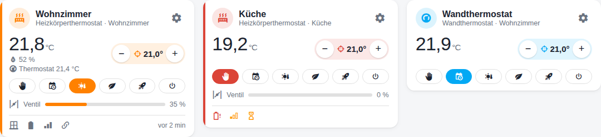
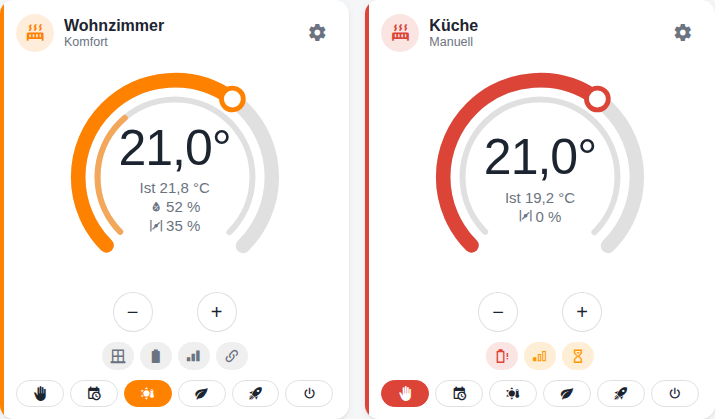
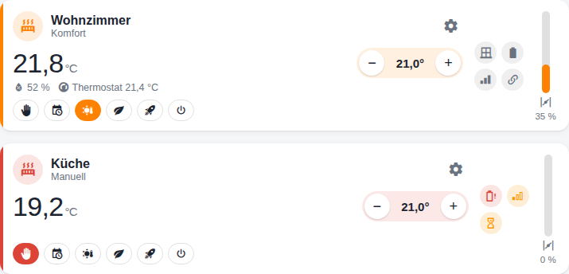

# Thermostatkarte

Eine eigene Dashboard-Karte für MAX!-Thermostate:
`eq3-max-thermostat-card`. Seit eq3_max 0.11.0 wird sie mit der Integration ausgeliefert
(vorher ein eigenes Repository). Sie zeigt auf einen Blick, was die eingebaute HA-Karte nicht zeigt –
Ventilstellung, Batterie, Funkempfang, verknüpftes Fenster – und lässt Einstellungen und
Wochenprogramm direkt im Dashboard ändern.


## Installation

Es ist nichts zu installieren: Die Integration bringt die Karte mit und trägt sie selbst
unter Einstellungen → Dashboards → Ressourcen ein (`/eq3_max_static/eq3-max-thermostat-card.js`),
bei jedem Update in der passenden Version. Karte und Integration haben dieselbe
Versionsnummer.

Im Dashboard **Karte hinzufügen → „eQ-3 MAX! Thermostat“**, Thermostat wählen. Erscheint die
Karte nach einem Update nicht, die Seite im Browser einmal neu laden.

!!! note "Ressourcen in configuration.yaml"
    Wer die Dashboard-Ressourcen in `configuration.yaml` pflegt (`resource_mode: yaml`),
    braucht ebenfalls nichts zu tun: Die Integration lädt die Karte dann selbst nach.

!!! info "Karte bisher über HACS installiert?"
    Die getrennt installierte Karte bleibt in Gebrauch, bis sie entfernt ist; die
    Integration lädt ihre eigene nicht zusätzlich und meldet das unter
    Einstellungen → Reparaturen. Karte in HACS entfernen (von Hand installiert: den Eintrag
    unter Ressourcen und die Datei in `/config/www/` löschen) und Home Assistant neu
    starten. An den Dashboards ändert sich nichts.

```yaml
type: custom:eq3-max-thermostat-card
entity: climate.wohnzimmer
layout: kompakt      # kompakt | ring | kachel
name: Wohnzimmer     # optional, sonst der Gerätename
show_modes: true     # optional, Modus-Knöpfe zeigen
temperature_sensor: sensor.wohnzimmer_temperatur  # optional
humidity_sensor: sensor.wohnzimmer_feuchte        # optional
```

Sie wird bei „Karte hinzufügen → Nach Entität“ für MAX!-Thermostate unter
„Community“ vorgeschlagen.

### Externe Sensoren

Hängt das Thermostat am Heizkörper, misst es dort oft wärmer oder kälter als im Raum.
`temperature_sensor` zeigt stattdessen einen Raumsensor als Ist-Temperatur; ist er nicht
verfügbar, nimmt die Karte wieder den Wert des Thermostats. `humidity_sensor` zeigt die
Luftfeuchte. Beide lassen sich im visuellen Editor auswählen.

Das ist **nur Anzeige**: Das Thermostat regelt weiter nach seinem eigenen Fühler. Deshalb steht
dessen Wert klein darunter („Thermostat 21,4 °C“, im Ring als Tooltip über „Ist“) – eine große
Abweichung erklärt, warum ein Raum wärmer oder kälter wird als erwartet.

## Drei Layouts

| Layout | Bild | Wofür |
|---|---|---|
| `kompakt` (Standard) |  | Raster im Dashboard; schmale Karten zeigen die Modi als Symbolzeile |
| `ring` |  | wie die HA-Thermostatkarte: **Sollwert durch Ziehen oder Tippen am Ring**, innen die Ventilöffnung |
| `kachel` |  | Querformat für Tablets und Wandpanels, Ventil als senkrechter Füllstand |

## Bedienung

- **−/+** ändert den Sollwert in 0,5-°C-Schritten (4,5–30,5 °C). Ein noch nicht quittierter
  Sollwert zählt mit, mehrmaliges Tippen summiert sich. In Automatik gilt der neue Wert bis zum
  nächsten Schaltpunkt, im manuellen Betrieb dauerhaft (siehe [Thermostat bedienen](bedienung.md#sollwert-andern)).
- **Modus-Knöpfe:** Manuell, Auto (Wochenprogramm), Komfort, Eco, Boost, Aus. Ist das Thermostat
  abwesend geschaltet, steht „Abwesend bis …“ da; ein Modus-Knopf beendet es.
- **Klick auf die Ist-Temperatur** öffnet den Home-Assistant-Dialog mit dem Verlauf, **Klick auf
  das Ventil** den Ventilverlauf. Im Ring öffnet ein Tipp in die Mitte den Verlauf; Feuchte- und Ventilzeile öffnen ihren eigenen.
  Nur der Bogen selbst stellt den Sollwert ein (ab 0.1.2; vorher setzte ein Tippen aufs Ventil 30,5 °C).
- Der farbige Streifen links zeigt den Zustand: orange = heizt, orange-gelb = Fenster offen,
  rot = Batterie schwach oder Funkfehler.

## Symbole

| Symbol | Bedeutung |
|---|---|
| Fenster zu / offen (orange) | verknüpfter Fensterkontakt des Geräts oder seines Raums – oder die eigene Fenster-auf-Erkennung des Thermostats |
| Batterie / Batterie-Warnung (rot) | MAX! meldet nur „ok“ oder „schwach“ |
| Signal 3 / 2 / 1 (orange) / aus (rot) | über −70 dBm, −70…−85, unter −85 dBm, Funkfehler (Mouseover: dBm) |
| Kette | verknüpft (Mouseover: mit wem) |
| Schloss | Bediensperre am Gerät |
| Sanduhr | Befehl gesendet, noch nicht quittiert |
| „vor 2 min“ | wann das Gerät zuletzt gemeldet hat |

**Eigene Symbole** (ab 0.11.0): Die Karte übernimmt, was in Home Assistant an der Entität
eingestellt ist. Ein dort gewähltes Symbol des Thermostats (etwa für eine Fußbodenheizung)
ersetzt Heizkörper bzw. Thermostat im Kopf der Karte. Ein verknüpfter Kontakt mit der
Geräteklasse „Tür“ oder „Garagentor“ erscheint als Tür bzw. Tor und heißt „Tür offen“;
hat der Kontakt ein eigenes Symbol, wird dieses gezeigt. Sind mehrere Kontakte verknüpft,
bestimmt ein offener das Symbol. Eingestellt wird das in den Einstellungen der jeweiligen
Entität („Symbol“ und „Anzeigen als“).

## Einstellungen im Pop-up

Das **Zahnrad** öffnet die Einstellungen, ohne das Dashboard zu verlassen (am Handy von unten).
Jeder Wert hat einen Mouseover-Text und ein **ⓘ**, das die Erklärung aufklappt.


| Reiter | Inhalt |
|---|---|
| **Temperaturen** | Komfort, Eco, Maximal, Minimal, Offset; beim Heizkörper „Ist-Temperatur abfragen“ |
| **Fenster** | Fenster-auf-Temperatur und -Dauer; welche Fensterkontakte verknüpft sind und ihr Zustand |
| **Boost & Ventil** | Boost-Dauer und -Öffnung, Entkalkung, Ventil maximal/Offset – beim Wandthermostat **Boost & Anzeige** (Boost-Dauer, Anzeige Soll/Ist) |
| **Wochenprogramm** | siehe unten |
| **Info** | Batterie, Funk je Modul, zuletzt gemeldet, Verknüpfungen, Bediensperre, Seriennummer, Firmware |

Geänderte Werte werden blau markiert und gehen erst mit **Übernehmen** raus – jeder Satz als
ein Telegramm. Danach steht „Gesendet – wartet auf Quittung“, bis das Gerät bestätigt
(„Vom Gerät quittiert“). Werte mit **„gilt für den Raum“** gibt eq3_max an die verknüpften
Thermostate weiter.

### Wochenprogramm


- Oben die Woche als Farbbalken (blau = kühl, orange = warm). Die Geräte melden ihr Programm
  nicht: Gezeigt wird, was sie zuletzt quittiert haben; unbekannte Tage stehen grau da.
- Tag antippen → Zeiträume bearbeiten (Endzeit in 5-Minuten-Schritten, Temperatur, einfügen,
  löschen). Ein unbekannter Tag startet mit dem Werksprogramm als Vorlage.
- **Schreiben auf:** die Tage wählen, auf die das Programm geht („alle“ für die ganze Woche).
- **Kopieren von …** lädt den Tag eines anderen Thermostats in den Editor.
- **Geht auch an:** eq3_max schreibt das Programm auch an die Thermostate des Raums.
- Jeder Tag ist ein Funktelegramm; bei knappem Funkbudget kann eine Woche einige Minuten dauern.
  Der Fortschritt steht im Reiter („schreibt: Di, Mi“).

## Wer darf was

Temperatur, Modus und Presets sind für alle Benutzer frei. Geräteeinstellungen und
Wochenprogramme lassen sich in den [Optionen](dienste.md#optionen) von eq3_max für Benutzer
ohne Admin-Rechte sperren; die Karte zeigt ihnen dann nur die Werte („Nur Anzeige“). Die
Sperre setzt die Integration selbst durch, sie gilt also auch außerhalb der Karte.

## Woher die Karte ihre Daten hat

Die Karte braucht keine Admin-Rechte und keine eigenen Einstellungen: Sie findet alle Entitäten
eines Thermostats über sein Gerät (umbenannte Entitäten stören nicht) und liest Fenster, Raum,
Wochenprogramm und Freigaben aus Attributen des Thermostats (`fenster`, `raum`,
`wochenprogramm`, `wochenprogramm_schreibt`, `wochenprogramm_fehler`, `einstellungen_frei`,
`wochenprogramm_frei`; nicht im Recorder). Geschrieben wird über die normalen Entitäten und den
Dienst `eq3_max.set_week_profile`.
