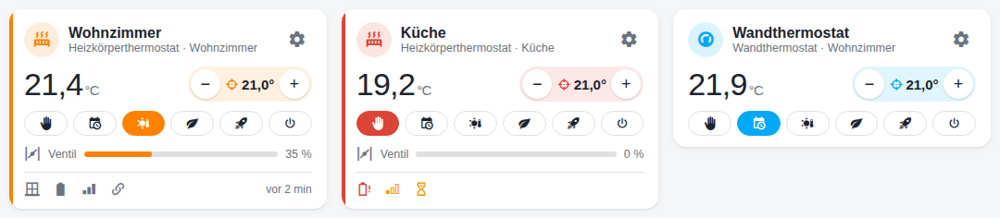
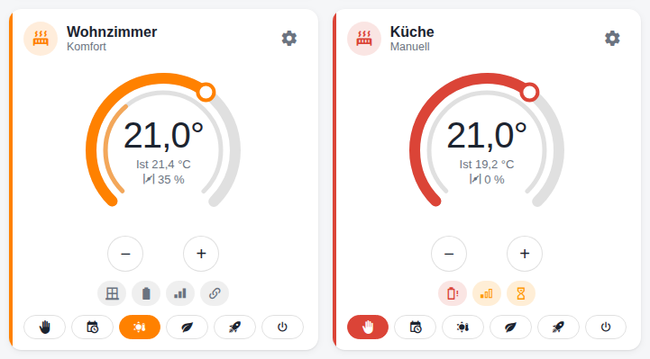
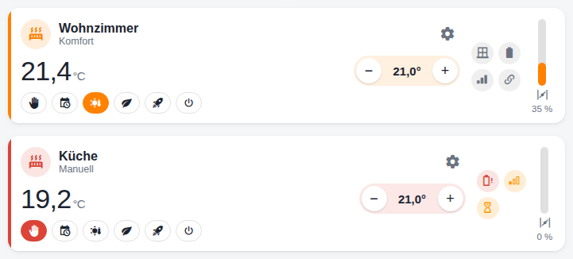

# Thermostatkarte

Eine eigene Dashboard-Karte für MAX!-Thermostate:
[eq3-max-thermostat-card](https://github.com/ma-schmitz/eq3-max-thermostat-card) (eigenes Repository,
braucht eq3_max ab 0.8.0). Sie zeigt auf einen Blick, was die eingebaute HA-Karte nicht zeigt –
Ventilstellung, Batterie, Funkempfang, verknüpftes Fenster – und lässt Einstellungen und
Wochenprogramm direkt im Dashboard ändern.


## Installation

1. HACS → ⋮ → **Benutzerdefinierte Repositories** →
   `https://github.com/ma-schmitz/eq3-max-thermostat-card`, Kategorie **Dashboard** → installieren.
   (Ohne HACS: `eq3-max-thermostat-card.js` nach `/config/www/` kopieren und unter
   Einstellungen → Dashboards → Ressourcen als *JavaScript-Modul* eintragen.)
2. Im Dashboard **Karte hinzufügen → „eQ-3 MAX! Thermostat“**, Thermostat wählen.

```yaml
type: custom:eq3-max-thermostat-card
entity: climate.wohnzimmer
layout: kompakt      # kompakt | ring | kachel
name: Wohnzimmer     # optional, sonst der Gerätename
show_modes: true     # optional, Modus-Knöpfe zeigen
```

## Drei Layouts

| Layout | Bild | Wofür |
|---|---|---|
| `kompakt` (Standard) |  | Raster im Dashboard; schmale Karten zeigen die Modi als Symbolzeile |
| `ring` |  | wie die HA-Thermostatkarte: **Sollwert durch Ziehen oder Tippen am Ring**, innen die Ventilöffnung |
| `kachel` |  | Querformat für Tablets und Wandpanels, Ventil als senkrechter Füllstand |

## Bedienung

- **−/+** ändert den Sollwert in 0,5-°C-Schritten (4,5–30,5 °C). Ein noch nicht quittierter
  Sollwert zählt mit, mehrmaliges Tippen summiert sich.
- **Modus-Knöpfe:** Manuell, Auto (Wochenprogramm), Komfort, Eco, Boost, Aus. Ist das Thermostat
  abwesend geschaltet, steht „Abwesend bis …“ da; ein Modus-Knopf beendet es.
- **Klick auf die Ist-Temperatur** öffnet den Home-Assistant-Dialog mit dem Verlauf, **Klick auf
  das Ventil** den Ventilverlauf. Im Ring öffnet ein Tipp in die Mitte den Verlauf.
- Der farbige Streifen links zeigt den Zustand: orange = heizt, orange-gelb = Fenster offen,
  rot = Batterie schwach oder Funkfehler.

## Symbole

| Symbol | Bedeutung |
|---|---|
| Fenster zu / offen (orange) | verknüpfter Fensterkontakt des Geräts oder seines Raums – oder die eigene Fenster-auf-Erkennung des Thermostats |
| Batterie / Batterie-Warnung (rot) | MAX! meldet nur „ok“ oder „schwach“ |
| Signal 3 / 2 / 1 (orange) / aus (rot) | über −70 dBm, −70…−85, unter −85 dBm, Funkfehler (Mouseover: dBm) |
| Kette | verknüpft (Mouseover: mit wem) |
| Schloss | Bediensperre am Gerät |
| Sanduhr | Befehl gesendet, noch nicht quittiert |
| „vor 2 min“ | wann das Gerät zuletzt gemeldet hat |

## Einstellungen im Pop-up

Das **Zahnrad** öffnet die Einstellungen, ohne das Dashboard zu verlassen (am Handy von unten).
Jeder Wert hat einen Mouseover-Text und ein **ⓘ**, das die Erklärung aufklappt.


| Reiter | Inhalt |
|---|---|
| **Temperaturen** | Komfort, Eco, Maximal, Minimal, Offset; beim Heizkörper „Ist-Temperatur abfragen“ |
| **Fenster** | Fenster-auf-Temperatur und -Dauer; welche Fensterkontakte verknüpft sind und ihr Zustand |
| **Boost & Ventil** | Boost-Dauer und -Öffnung, Entkalkung, Ventil maximal/Offset – beim Wandthermostat **Boost & Anzeige** (Boost-Dauer, Anzeige Soll/Ist) |
| **Wochenprogramm** | siehe unten |
| **Info** | Batterie, Funk je Modul, zuletzt gemeldet, Verknüpfungen, Bediensperre, Seriennummer, Firmware |

Geänderte Werte werden blau markiert und gehen erst mit **Übernehmen** raus – jeder Satz als
ein Telegramm. Danach steht „Gesendet – wartet auf Quittung“, bis das Gerät bestätigt
(„Vom Gerät quittiert“). Werte mit **„gilt für den Raum“** gibt eq3_max an die verknüpften
Thermostate weiter.

### Wochenprogramm


- Oben die Woche als Farbbalken (blau = kühl, orange = warm). Die Geräte melden ihr Programm
  nicht: Gezeigt wird, was sie zuletzt quittiert haben; unbekannte Tage stehen grau da.
- Tag antippen → Zeiträume bearbeiten (Endzeit in 5-Minuten-Schritten, Temperatur, einfügen,
  löschen). Ein unbekannter Tag startet mit dem Werksprogramm als Vorlage.
- **Schreiben auf:** die Tage wählen, auf die das Programm geht („alle“ für die ganze Woche).
- **Kopieren von …** lädt den Tag eines anderen Thermostats in den Editor.
- **Geht auch an:** eq3_max schreibt das Programm auch an die Thermostate des Raums.
- Jeder Tag ist ein Funktelegramm; bei knappem Funkbudget kann eine Woche einige Minuten dauern.
  Der Fortschritt steht im Reiter („schreibt: Di, Mi“).

## Wer darf was

Temperatur, Modus und Presets sind für alle Benutzer frei. Geräteeinstellungen und
Wochenprogramme lassen sich in den [Optionen](dienste.md#optionen) von eq3_max für Benutzer
ohne Admin-Rechte sperren; die Karte zeigt ihnen dann nur die Werte („Nur Anzeige“). Die
Sperre setzt die Integration selbst durch, sie gilt also auch außerhalb der Karte.

## Woher die Karte ihre Daten hat

Die Karte braucht keine Admin-Rechte und keine eigenen Einstellungen: Sie findet alle Entitäten
eines Thermostats über sein Gerät (umbenannte Entitäten stören nicht) und liest Fenster, Raum,
Wochenprogramm und Freigaben aus Attributen des Thermostats (`fenster`, `raum`,
`wochenprogramm`, `wochenprogramm_schreibt`, `wochenprogramm_fehler`, `einstellungen_frei`,
`wochenprogramm_frei`; nicht im Recorder). Geschrieben wird über die normalen Entitäten und den
Dienst `eq3_max.set_week_profile`.
