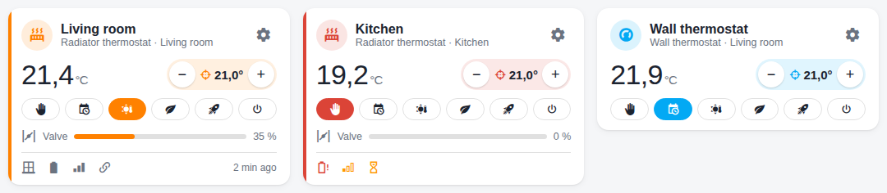
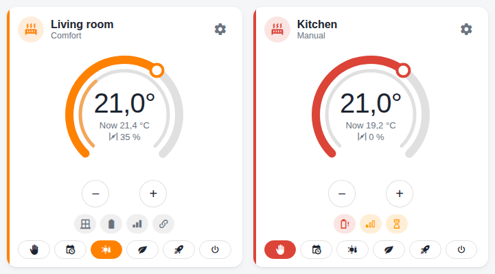
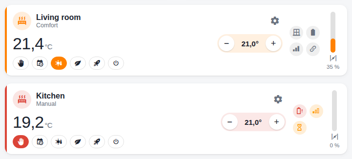

# Thermostat card

A dashboard card of its own for MAX! thermostats:
[eq3-max-thermostat-card](https://github.com/ma-schmitz/eq3-max-thermostat-card) (own repository,
needs eq3_max 0.8.0 or newer). It shows at a glance what the built-in HA card does not – valve
position, battery, radio reception, linked window – and lets you change settings and the week
program right in the dashboard.


## Installation

1. HACS → ⋮ → **Custom repositories** →
   `https://github.com/ma-schmitz/eq3-max-thermostat-card`, category **Dashboard** → install.
   (Without HACS: copy `eq3-max-thermostat-card.js` to `/config/www/` and add it under
   Settings → Dashboards → Resources as *JavaScript module*.)
2. In the dashboard **Add card → "eQ-3 MAX! Thermostat"**, pick the thermostat.

```yaml
type: custom:eq3-max-thermostat-card
entity: climate.living_room
layout: kompakt      # kompakt | ring | kachel
name: Living room    # optional, otherwise the device name
show_modes: true     # optional, show the mode buttons
```

## Three layouts

| Layout | Picture | For |
|---|---|---|
| `kompakt` (default) |  | dashboard grids; narrow cards show the modes as one row of symbols |
| `ring` |  | like the HA thermostat card: **set the target by dragging or tapping the ring**, valve opening inside |
| `kachel` (tile) |  | landscape for tablets and wall panels, valve as a vertical level |

## Operation

- **−/+** changes the target in 0.5 °C steps (4.5–30.5 °C). A target not acknowledged yet
  counts, so several taps add up.
- **Mode buttons:** Manual, Auto (week program), Comfort, Eco, Boost, Off. When the thermostat
  is set to away, "Away until …" shows; a mode button ends it.
- **Click the current temperature** to open Home Assistant's dialog with its history, **click the
  valve** for the valve history. In the ring, tap the centre for the history.
- The coloured stripe on the left shows the state: orange = heating, amber = window open,
  red = battery low or radio error.

## Symbols

| Symbol | Meaning |
|---|---|
| window closed / open (amber) | linked window contact of the device or its room – or the thermostat's own open-window detection |
| battery / battery alert (red) | MAX! only reports "ok" or "low" |
| signal 3 / 2 / 1 (amber) / off (red) | above −70 dBm, −70…−85, below −85 dBm, radio error (hover: dBm) |
| link | linked (hover: with whom) |
| lock | operation lock on the device |
| hourglass | command sent, not acknowledged yet |
| "2 min ago" | when the device last reported |

## Settings in the pop-up

The **cog** opens the settings without leaving the dashboard (from the bottom on phones).
Every value has a hover text and an **ⓘ** that unfolds the explanation.


| Tab | Content |
|---|---|
| **Temperatures** | comfort, eco, maximum, minimum, offset; on radiators "Poll current temperature" |
| **Window** | window-open temperature and duration; which window contacts are linked and their state |
| **Boost & valve** | boost duration and opening, decalcification, valve maximum/offset – on the wall thermostat **Boost & display** (boost duration, display set/current) |
| **Week program** | see below |
| **Info** | battery, radio per module, last seen, links, operation lock, serial number, firmware |

Changed values are marked blue and go out only with **Apply** – each set as one telegram. Then
"Sent – waiting for acknowledgement" shows until the device confirms ("Acknowledged by the
device"). Values marked **"applies to the room"** are passed on by eq3_max to the linked
thermostats.

### Week program


- At the top the week as coloured bars (blue = cool, orange = warm). The devices do not report
  their program: shown is what they acknowledged last; unknown days are grey.
- Tap a day → edit its periods (end time in 5-minute steps, temperature, insert, delete). An
  unknown day starts with the factory program as template.
- **Write to:** choose the days the program goes to ("all" for the whole week).
- **Copy from …** loads the day of another thermostat into the editor.
- **Also goes to:** eq3_max writes the program to the thermostats of the room as well.
- Every day is one radio telegram; with little airtime left a week can take a few minutes. The
  progress shows in the tab ("writing: Tu, We").

## Who may do what

Temperature, mode and presets are open to all users. Device settings and week programs can be
locked for users without admin rights in the [options](dienste.md#options) of eq3_max; the
card then only shows them the values ("View only"). The integration enforces this itself, so it
also applies outside the card.

## Where the card gets its data

The card needs neither admin rights nor settings of its own: it finds all entities of a
thermostat through its device (renamed entities do not matter) and reads window, room, week
program and permissions from attributes of the thermostat (`fenster`, `raum`,
`wochenprogramm`, `wochenprogramm_schreibt`, `wochenprogramm_fehler`, `einstellungen_frei`,
`wochenprogramm_frei`; not recorded). It writes through the normal entities and the service
`eq3_max.set_week_profile`.
