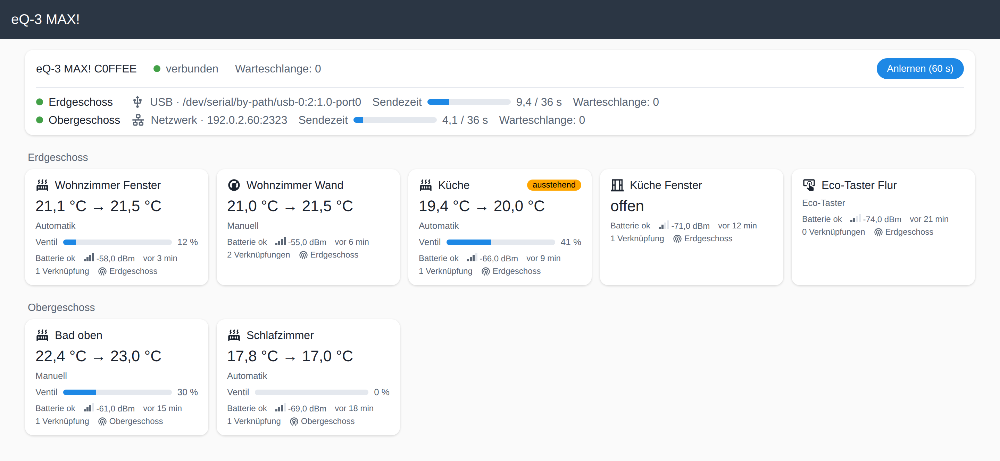

# Seite „eQ-3 MAX!“

Alles aus [Gerätekonfiguration](konfiguration.md) und [Verknüpfungen](verknuepfungen.md) (und das Anlernen) gibt es auch grafisch: Eintrag **„eQ-3 MAX!“** in der
Seitenleiste (nur Administratoren). Auf der Geräteseite des Funkmoduls und jedes Geräts führt
**„Besuchen“** dorthin.

**Kopf:** Name der Zentrale mit Zustand (verbunden / getrennt) und Knopf **„Anlernen (60 s)“**
mit Countdown. Darunter eine Kachel je Funkmodul: USB-Pfad bzw. Netzwerkziel (der Stift neben dem Namen benennt das Modul um), Warteschlange
und Sendezeit der letzten Stunde als Balken (Grenze 36 s; gelb ab der Hälfte, rot ab 80 %).
Eine Leiste mit Kennzahlen zählt Thermostate, gerade heizende Thermostate (Ventil offen),
offene Fenster, schwache Batterien und auffällige Geräte (ausstehend, nicht quittiert,
Funkfehler); was nicht null ist, ist farbig hinterlegt.

**Gerätekarten**, nach HA-Bereich gruppiert („Ohne Bereich“ zuletzt):

| Gerät | Karte zeigt |
|---|---|
| Heizkörperthermostat | Ist → Soll, Modus/Preset, Ventil-Balken |
| Wandthermostat | Ist → Soll, Modus/Preset |
| Fensterkontakt | offen / geschlossen |
| Eco-Taster | – |

Dazu bei allen: Batterie, RSSI (Balken und dBm), „zuletzt gemeldet“, Zahl der Verknüpfungen
(bei mehreren Funkmodulen auch das Modul). Farbe und Randstreifen zeigen den Zustand:
**orange** = Ventil offen bzw. Fenster offen, **rot** = Batterie schwach, Funkfehler oder nicht
quittiert, ohne Streifen = Ruhe.
Markierungen: **ausstehend** (Befehl, Konfiguration oder Verknüpfung noch nicht quittiert),
**nicht quittiert** (Versuche ausgeschöpft, geht beim nächsten Melden erneut raus),
**Funkfehler**, **Batterie schwach**.

**Klick auf eine Karte** öffnet das Seitenfenster:

- **Verknüpfungen:** jeder Partner mit Zustand — verknüpft · ausstehend · wartet auf Gerät ·
  fehlgeschlagen · abgelehnt · einseitig — darunter der Klartext (z. B. „wartet auf
  Fensterkontakt – bitte Fenster einmal öffnen und schließen“). Knöpfe: **Lösen**,
  bei fehlgeschlagenen **Erneut senden**, bei einseitigen **Verknüpfen**.
  **Partner hinzufügen** bietet nur Geräte an, die sich mit diesem verknüpfen lassen und
  noch nicht verknüpft oder beauftragt sind; hinter jedem steht sein Bereich (ab 0.8.1).
  **Mit allen Geräten im Bereich verknüpfen** (ab 0.8.1) verknüpft das Gerät mit allen
  passenden Geräten desselben Home-Assistant-Bereichs und listet vorher auf, was beauftragt wird. Bei Fensterkontakt und Taster steht oben der
  Hinweis, dass Änderungen erst nach dem nächsten Öffnen/Schließen bzw. Drücken rausgehen.
- **Konfiguration** (nur Thermostate): Satz **Temperaturen** (komfort, eco, maximal, minimal,
  offset, fenster_temperatur, fenster_dauer), beim Heizkörperthermostat zusätzlich **Ventil**
  (boost_dauer, boost_ventil, entkalkung_tag, entkalkung_stunde, ventil_max, ventil_offset),
  beim Wandthermostat **Ventil** nur mit boost_dauer und zusätzlich **Anzeige**
  (Soll- oder Ist-Temperatur im Display, ab 0.8.0).
  - Je Wert die Quelle (**Homegear** / **Werksvorgabe** / **gesetzt**) und, wenn gesendet aber
    nicht quittiert, „ausstehend: <Wert>“ neben dem quittierten. Das steht nur bei Werten, die
    sich vom quittierten unterscheiden; dass der ganze Satz unterwegs ist, zeigt „Satz
    ausstehend“ (die Entitäten führen dagegen jeden Wert des Satzes unter `ausstehend`).
  - Mehrere Werte ändern (geänderte Felder sind blau umrandet, Werte außerhalb des Rasters
    rot mit Hinweis), dann **„Satz senden“**. Die Seite zeigt vorher die Änderungen und die
    **Werksvorgaben, die mitgehen** (nie vom Gerät gelesene Werte) — erst „Senden“ schickt
    den Satz, als **ein** Telegramm. „Verwerfen“ setzt das Formular zurück.
  - Jeder Wert hat einen **Mouseover-Text**, der erklärt, was er am Gerät bewirkt; das **ⓘ**
    daneben klappt dieselbe Erklärung auf (für Handy und Tablet, ab 0.8.0).
  - Beim Heizkörperthermostat darunter **„Ist-Temperatur abfragen“** (aus, alle 15 min … 4 h,
    ab 0.8.0), siehe [Gerätekonfiguration](konfiguration.md#ist-temperatur-abfragen-ab-080).
- **Gruppen-ID** (im Reiter Verknüpfungen, nur Thermostate, ab 0.8.0): aktuelle ID, ausstehende
  ID, **Setzen**, **Entfernen** und **Für den Raum vergeben**, siehe
  [Verknüpfungen](verknuepfungen.md#gruppen-id-ab-080).
- Die Seite aktualisiert sich von selbst. Während man in ein Feld tippt, wartet die
  Aktualisierung, bis man es verlässt.
- **Wochenprogramm** (nur Thermostate, ab 0.6.0): oben die zuletzt quittierten Tage („nicht
  geschrieben“, solange die Integration den Tag nie geschrieben hat; die Geräte melden ihr
  Programm nicht), „In den Editor“ übernimmt einen Tag. Darunter der Editor: Tage ankreuzen
  (oder „alle“), Punkte mit Temperatur und Bis-Uhrzeit (der letzte gilt bis 24:00, bis zu 13),
  **„Schreiben“** wartet auf die Quittungen des Geräts. Geschrieben wird im Hintergrund: Die
  Seite darf zwischendurch geschlossen werden, beim nächsten Öffnen steht oben, welche Tage noch
  offen sind, ob das Funkmodul gerade auf Sendezeit wartet (dann dauert eine ganze Woche eine
  Viertelstunde und mehr) oder warum das letzte Schreiben abgebrochen ist. Zuletzt „Auf andere Thermostate
  kopieren“ mit dem gespeicherten Programm. Unter **Löschen** zwei Knöpfe, beide mit Nachfrage und
  für alle sieben Tage: **Werksprogramm schreiben** (das Programm ab Werk) und **Feste Temperatur
  schreiben** (ein Punkt bis 24:00 mit der eingegebenen Temperatur) – ein Thermostat hat immer ein
  Programm, löschen heißt ein neues schreiben.

Die Seite folgt der Sprache des Benutzers in Home Assistant (Deutsch oder Englisch, ab 0.7.0).
Mit mehreren Funkmodulen steht neben „Anlernen“ die Auswahl des Moduls
(siehe [Geräte anlernen](anlernen.md)).

Nicht auf der Seite: Werksreset ([Dienste](dienste.md)), Namen und Bereiche (wie gewohnt in HA).
