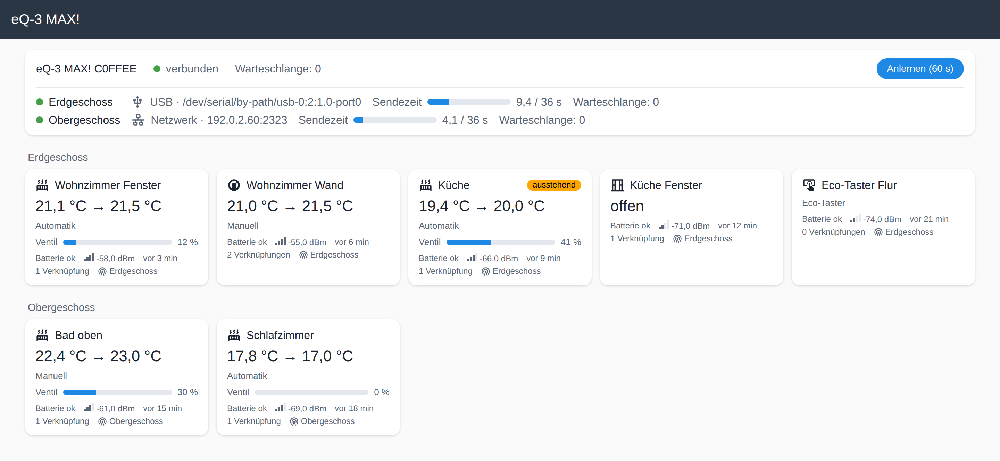

# Seite „eQ-3 MAX!“

Alles aus [Gerätekonfiguration](konfiguration.md) und [Verknüpfungen](verknuepfungen.md) (und das Anlernen) gibt es auch grafisch: Eintrag **„eQ-3 MAX!“** in der
Seitenleiste (nur Administratoren). Auf der Geräteseite des Funkmoduls und jedes Geräts führt
**„Besuchen“** dorthin.

**Kopfzeile** (je Funkmodul): verbunden/getrennt · USB-Pfad bzw. Netzwerkziel · Sendezeit der
letzten Stunde als Balken (Grenze 36 s; gelb ab der Hälfte, rot ab 80 %) · Warteschlange ·
Knopf **„Anlernen (60 s)“** mit Countdown.

**Gerätekarten**, nach HA-Bereich gruppiert („Ohne Bereich“ zuletzt):

| Gerät | Karte zeigt |
|---|---|
| Heizkörperthermostat | Ist → Soll, Modus/Preset, Ventil-Balken |
| Wandthermostat | Ist → Soll, Modus/Preset |
| Fensterkontakt | offen / geschlossen |
| Eco-Taster | – |

Dazu bei allen: Batterie, RSSI (Balken und dBm), „zuletzt gemeldet“, Zahl der Verknüpfungen.
Markierungen: **ausstehend** (Befehl, Konfiguration oder Verknüpfung noch nicht quittiert),
**nicht quittiert** (Versuche ausgeschöpft, geht beim nächsten Melden erneut raus),
**Funkfehler**, **Batterie schwach**.

**Klick auf eine Karte** öffnet das Seitenfenster:

- **Verknüpfungen:** jeder Partner mit Zustand — verknüpft · ausstehend · wartet auf Gerät ·
  fehlgeschlagen · abgelehnt · einseitig — darunter der Klartext (z. B. „wartet auf
  Fensterkontakt – bitte Fenster einmal öffnen und schließen“). Knöpfe: **Lösen**,
  bei fehlgeschlagenen **Erneut senden**, bei einseitigen **Verknüpfen**.
  **Partner hinzufügen** bietet nur Geräte an, die sich mit diesem verknüpfen lassen und
  noch nicht verknüpft oder beauftragt sind. Bei Fensterkontakt und Taster steht oben der
  Hinweis, dass Änderungen erst nach dem nächsten Öffnen/Schließen bzw. Drücken rausgehen.
- **Konfiguration** (nur Thermostate): Satz **Temperaturen** (komfort, eco, maximal, minimal,
  offset, fenster_temperatur, fenster_dauer), beim Heizkörperthermostat zusätzlich **Ventil**
  (boost_dauer, boost_ventil, entkalkung_tag, entkalkung_stunde, ventil_max, ventil_offset).
  - Je Wert die Quelle (**Homegear** / **Werksvorgabe** / **gesetzt**) und, wenn gesendet aber
    nicht quittiert, „ausstehend: <Wert>“ neben dem quittierten. Das steht nur bei Werten, die
    sich vom quittierten unterscheiden; dass der ganze Satz unterwegs ist, zeigt „Satz
    ausstehend“ (die Entitäten führen dagegen jeden Wert des Satzes unter `ausstehend`).
  - Mehrere Werte ändern (geänderte Felder sind blau umrandet, Werte außerhalb des Rasters
    rot mit Hinweis), dann **„Satz senden“**. Die Seite zeigt vorher die Änderungen und die
    **Werksvorgaben, die mitgehen** (nie vom Gerät gelesene Werte) — erst „Senden“ schickt
    den Satz, als **ein** Telegramm. „Verwerfen“ setzt das Formular zurück.
- Die Seite aktualisiert sich von selbst. Während man in ein Feld tippt, wartet die
  Aktualisierung, bis man es verlässt.

Nicht auf der Seite: Werksreset ([Dienste](dienste.md)), Namen und Bereiche (wie gewohnt in HA),
Wochenprofile.
