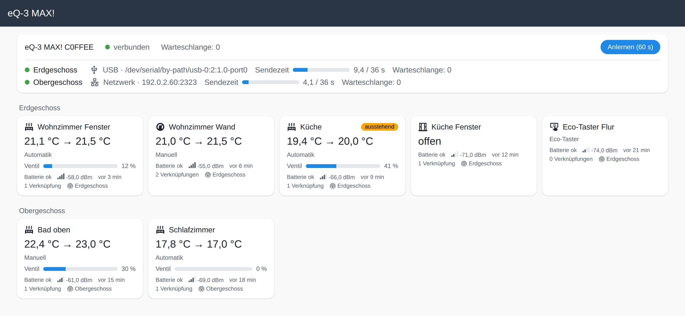

# The "eQ-3 MAX!" panel

Everything from [Device configuration](konfiguration.md) and [Links](verknuepfungen.md) (and pairing) is also available graphically: the **"eQ-3 MAX!"** entry in the
sidebar (administrators only). On the device page of the radio module and of every device,
**"Visit"** leads there.

**Header:** name of the central unit with its state (connected / disconnected) and the
**"Pair (60 s)"** button with countdown. Below it one tile per radio module: USB path or
network target (the pencil next to the name renames the module), queue and the airtime of the last hour as a bar (limit 36 s; yellow
from half, red from 80 %). A bar of key figures counts thermostats, thermostats heating
right now (valve open), open windows, low batteries and devices needing attention (pending,
not acknowledged, radio error); anything that is not zero is highlighted in colour.

**Device cards**, grouped by HA area ("No area" last):

| Device | Card shows |
|---|---|
| Radiator thermostat | current → target, mode/preset, valve bar |
| Wall thermostat | current → target, mode/preset |
| Window contact | open / closed |
| Eco button | – |

Plus on all of them: battery, RSSI (bar and dBm), "last reported", number of links
(with several radio modules also the module). Colour and side stripe show the state:
**orange** = valve open or window open, **red** = battery low, radio error or not
acknowledged, no stripe = idle.
Markers: **pending** (command, configuration or link not yet acknowledged),
**not acknowledged** (attempts used up, goes out again on the next report),
**Radio error**, **Battery low**.

**Clicking a card** opens the side panel:

- **Links:** each partner with its state — linked · pending · waiting for device ·
  failed · rejected · one-sided — with the plain-text explanation below (e.g. "waiting for
  window contact – please open and close the window once"). Buttons: **Unlink**,
  for failed ones **Send again**, for one-sided ones **Link**.
  **Add partner** only offers devices that can be linked with this one and are not linked
  or requested yet. For window contacts and buttons a note at the top says that changes only
  go out after the next opening/closing or press.
- **Configuration** (thermostats only): set **Temperatures** (komfort, eco, maximal, minimal,
  offset, fenster_temperatur, fenster_dauer), on radiator thermostats additionally **Valve**
  (boost_dauer, boost_ventil, entkalkung_tag, entkalkung_stunde, ventil_max, ventil_offset);
  on wall thermostats **Valve** only with boost_dauer, plus **Display** (set or current
  temperature on the display, from 0.8.0).
  - For each value the source (**Homegear** / **Factory default** / **set**) and, if sent but
    not acknowledged, "pending: <value>" next to the acknowledged one. This only appears for
    values that differ from the acknowledged one; that the whole set is on its way is shown
    by "Set pending" (the entities, by contrast, list every value of the set under `ausstehend`).
  - Change several values (changed fields get a blue border, values off the grid turn red
    with a hint), then **"Send set"**. The panel first shows the changes and the
    **factory defaults that go along** (values never read from the device) — only "Send"
    sends the set, as **one** telegram. "Discard" resets the form.
  - Every value has a **hover text** explaining what it does on the device; the **ⓘ** next to
    it unfolds the same explanation (for phones and tablets, from 0.8.0).
  - On radiator thermostats below it **"Poll current temperature"** (off, every 15 min … 4 h,
    from 0.8.0), see [Device configuration](konfiguration.md#poll-the-current-temperature-from-080).
- **Group id** (in the Links tab, thermostats only, from 0.8.0): current id, pending id,
  **Set**, **Remove** and **Assign for the room**, see
  [Links](verknuepfungen.md#group-id-from-080).
- The panel refreshes by itself. While you are typing in a field, the refresh waits until
  you leave it.
- **Week program** (thermostats only, from 0.6.0): at the top the last acknowledged days
  ("not written" as long as the integration has never written that day; the devices do not
  report their program), "To the editor" takes over a day. Below it the editor: tick days
  (or "all"), points with temperature and until time (the last lasts until 24:00, up to 13),
  **"Write"** waits for the device's acknowledgements. Writing happens in the background: the
  panel may be closed in between; when it is opened again, the top shows which days are still
  to do, whether the radio module is waiting for airtime right now (then a whole week
  takes a quarter of an hour and more) or why the last write was aborted. Last, "Copy to other
  thermostats" with the stored program. Under **Clear** two buttons, both with a confirmation and
  for all seven days: **Write factory program** (the program as shipped) and **Write fixed
  temperature** (one point until 24:00 with the entered temperature) – a thermostat always has a
  program, clearing means writing a new one.

The panel follows the user's language in Home Assistant (German or English, from 0.7.0).
With several radio modules the module selection sits next to "Pair"
(see [Pairing devices](anlernen.md)).

Not on the panel: factory reset ([Services](dienste.md)), names and areas (as usual in HA).
